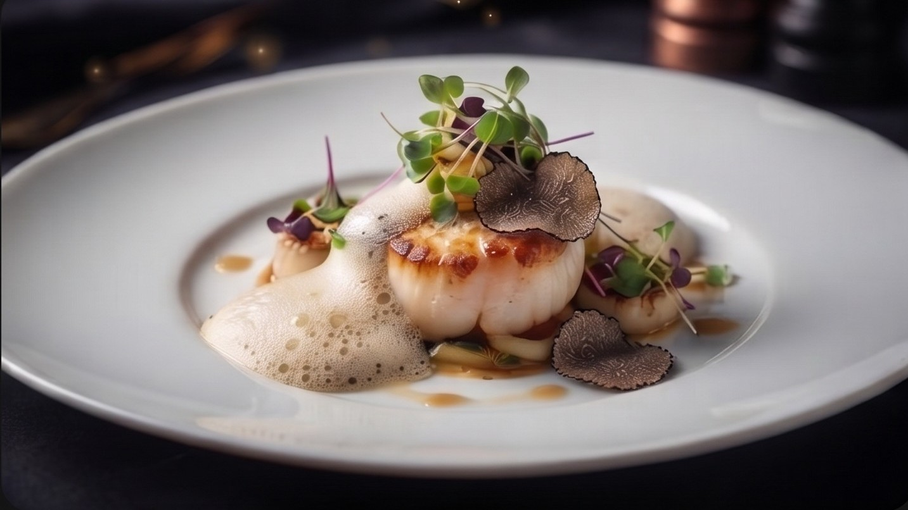

# 🍽️ Aveline - Luxury Fine Dining & Restaurant Landing Page

A premium, high-converting landing page designed specifically for upscale restaurants, luxury cafes, and fine-dining establishments. Built to captivate visitors with a sophisticated dark theme, ambient lighting effects, and elegant typography to maximize table reservations.




## ✨ Key Features

- **Premium Dark UI & Ambient Lighting:** Utilizes a deep "vampire black" background enhanced with custom CSS radial gradients to create a warm, glowing amber/gold atmosphere.
- **Elegant Typography:** A carefully selected pairing of `Playfair Display` for luxurious, classic headings and `Inter` for clean, readable body text.
- **Interactive Mobile Experience:** Features a custom-built, slide-in hamburger menu tailored for flawless navigation on smartphones and tablets.
- **Smart UX:** The mobile navigation automatically closes upon link selection, ensuring a frictionless user journey. 
- **High-Converting CTAs:** Strategically placed "Book a Table" and "Make a Reservation" buttons with smooth hover transitions and glowing shadows.

---

## 🛠️ Built With

- **HTML5** (Semantic & Accessible Markup)
- **CSS3** (Flexbox, CSS Variables, Custom Gradients, Advanced Media Queries)
- **Vanilla JavaScript** (ES6+ DOM Manipulation & Event Handling)
- **Google Fonts** (Playfair Display, Inter)
- **FontAwesome** (Vector Icons)

---

## 📂 Project Structure

```text
aveline-restaurant/
│
├── assets/
│   └── food.jpg
│
├── reset/
│   └── reset.css
│
├── index.html
├── style.css
├── script.js
└── README.md
